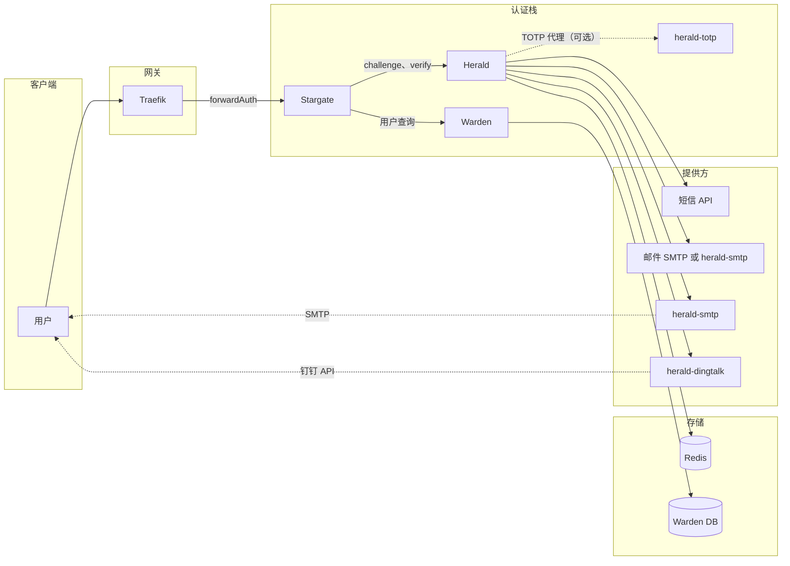

# Herald 架构说明

本文描述 Stargate、Warden、Herald、Redis 与外部提供方（短信、邮件、钉钉）组成的认证全栈架构。

## 概述

Herald 是 Stargate + Warden + Herald 体系中的 OTP 与验证码服务。Stargate（forwardAuth）负责登录编排；Warden 提供用户白名单与联系方式；Herald 负责创建 challenge、通过提供方发码、验码。使用 HTTP 适配器时，外部渠道凭据由独立服务持有，Herald 保存适配器 API key；使用内置 SMTP 时，Herald 读取自身的 `SMTP_*` 凭据。外部通道可由独立服务提供（如配置 `HERALD_SMTP_API_URL` 时邮件由 [herald-smtp](https://github.com/soulteary/herald-smtp) 提供，钉钉由 [herald-dingtalk](https://github.com/soulteary/herald-dingtalk) 提供）。

## 全栈架构

## 数据流与关键接口

### 登录流程（Challenge → Verify）

1. **用户** 访问受保护资源 → **Traefik** forwardAuth → **Stargate**（无会话）→ 跳转登录页。
2. 用户输入标识（邮箱/手机/用户名）。**Stargate** 调用 **Warden** 解析用户，获得 `user_id` 与 destination（email/phone/userid）。
3. **Stargate** 调用 **Herald** `POST /v1/otp/challenges`（user_id、channel、destination、purpose）。Herald 在 **Redis** 中创建 challenge，通过 **短信**、**邮件**（内置 SMTP 或配置 `HERALD_SMTP_API_URL` 时由 [herald-smtp](https://github.com/soulteary/herald-smtp) 发送）或 **herald-dingtalk**（provider send）发送验证码。
4. Herald 向 Stargate 返回 `challenge_id`、`expires_in`、`next_resend_in`。
5. 用户提交验证码。**Stargate** 调用 **Herald** `POST /v1/otp/verifications`（challenge_id、code）。
6. Herald 在 Redis 中校验，返回 `ok`、`user_id`、`amr`、`issued_at`。Stargate 创建会话（cookie/JWT）。
7. 后续 forwardAuth：Stargate 仅校验会话，**不再**调用 Warden 或 Herald。

### 关键接口

| 接口 | 方向 | 说明 |
|------|------|------|
| **创建 Challenge** | Stargate → Herald | `POST /v1/otp/challenges` — 创建 OTP challenge 并发送验证码 |
| **验码** | Stargate → Herald | `POST /v1/otp/verifications` — 校验验证码并返回 user_id/amr |
| **作废 Challenge** | Stargate → Herald | `POST /v1/otp/challenges/{id}/revoke` — 可选作废 |
| **TOTP（可选）** | Stargate → Herald | `GET /v1/totp/status`、`POST /v1/totp/verify`、`POST /v1/totp/enroll/start`、`POST /v1/totp/enroll/confirm`、`POST /v1/totp/revoke` — Herald 在配置 `HERALD_TOTP_ENABLED` 与 `HERALD_TOTP_BASE_URL` 时代理到 herald-totp |
| **Provider 发送** | Herald → Provider | `POST /v1/send`（HTTP）— Herald 调用短信/邮件/钉钉适配器；配置 `HERALD_SMTP_API_URL` 时邮件由 herald-smtp 发送，钉钉由 herald-dingtalk 发送 |
| **用户查询** | Stargate → Warden | Warden API — 将标识解析为 user_id 与 destination |

### Herald ↔ Redis

- **Challenge 数据**：`otp:ch:*` — challenge 载荷、验证码哈希、TTL、尝试次数。
- **限流**：`ratelimit:*` — 按用户、IP、destination 限流。
- **幂等**：`otp:idem2:*` — 发送前占位、不自动过期的发送记录或缓存的 challenge 响应。

## 安全边界

- **Stargate ↔ Herald**：请求认证使用 HMAC（创建必须 v3，携带版本、时间戳、nonce、service 等签名头）或 API Key。mTLS 是独立传输策略，不代替请求认证。
- **Herald ↔ Provider（如 herald-smtp、herald-dingtalk）**：可选 API Key（`HERALD_SMTP_API_KEY`、`HERALD_DINGTALK_API_KEY`）。使用适配器时，SMTP 与钉钉凭据位于对应服务；使用内置 SMTP 时，Herald 读取自身 `SMTP_*` 凭据。
- **PII**：验证码仅以哈希（如 Argon2）形式存于 Redis。destination（邮箱/手机）用于发送，审计日志中建议脱敏；禁止记录明文验证码。

## 相关文档

- [API.md](API.md) — Herald HTTP API（challenges、verifications、healthz）
- [DEPLOYMENT.md](DEPLOYMENT.md) — 配置、Redis 与 Provider 部署
- [SECURITY.md](SECURITY.md) — 认证与安全实践
- [TROUBLESHOOTING.md](TROUBLESHOOTING.md) — 常见问题（收不到验证码、验证码错误、401、限流等）

## 激活与持久化

`otp:active:v2:*` 按完整身份原值派生，激活与旧码删除原子执行；旧索引只有在身份完全匹配时才迁移。
升级步骤见 [激活索引升级](API.md#激活索引升级)。启用审计的实例还需私有、持久的本地审计目录，
仅保留 Redis 不能保存待投递审计积压。mTLS 是独立传输策略，不能代替 HMAC 或 API Key 请求认证。
